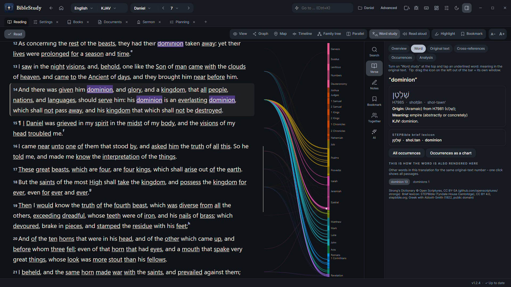
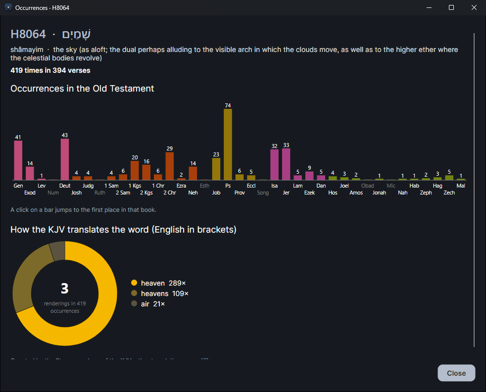
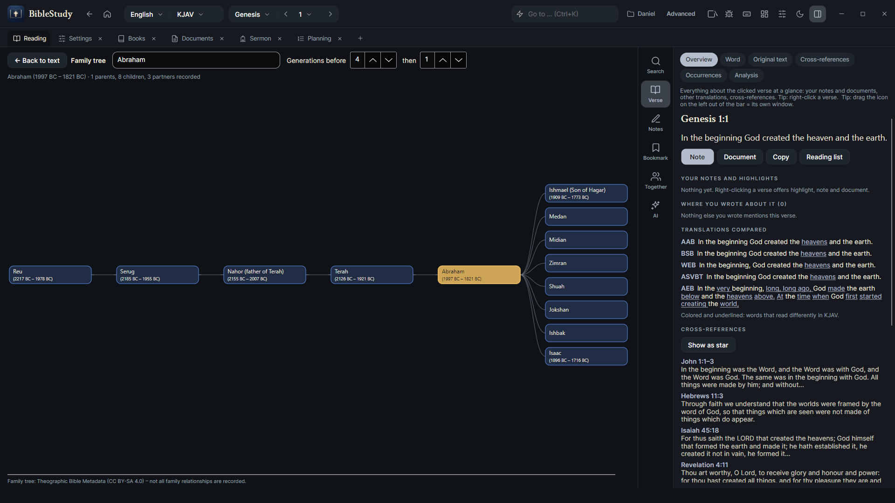
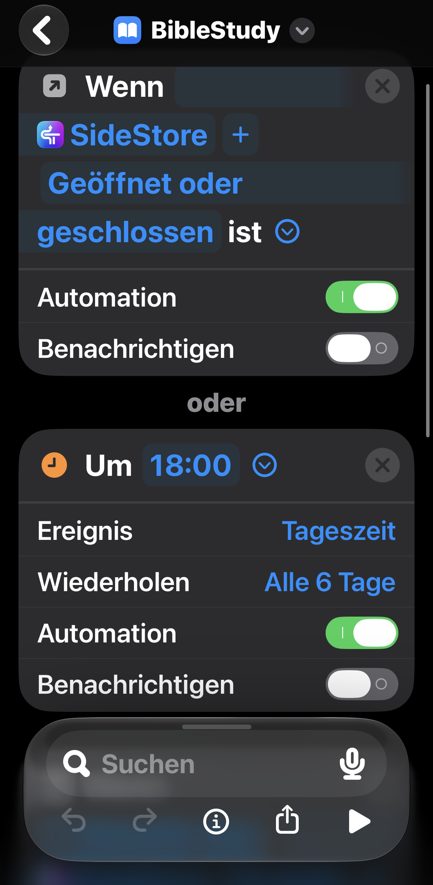

<p align="center"></p>

<p align="center"><a href="README.md"></a> <a href="README.de.md"></a></p>

<h1 align="center">BibleStudy</h1>

<p align="center"><b>Kostenlose Bibelstudien-Software für PC und Handy.</b><br>
Lesen, vergleichen, markieren, Notizen machen, den Grundtext studieren, Bibelstunden vorbereiten und halten.<br>
Läuft offline. Kein Konto. Keine Werbung. Quelloffen.</p>

<p align="center">
  <a href="https://github.com/Trofline/BibleStudy/releases/latest"></a>
  <a href="LICENSE"></a>
  <a href="https://github.com/Trofline/BibleStudy/actions/workflows/build.yml"></a>
  
</p>

<p align="center"><a href="https://trofline.github.io/BibleStudy/">Website</a> · <a href="docs/handbuch/README.md">Handbuch</a> · <a href="https://github.com/Trofline/BibleStudy/issues">Problem melden</a></p>

<br>

<p align="center"><a href="docs/img/tour.gif"></a></p>

## ⬇️ Herunterladen: wähle dein Gerät

<table>
  <tr>
    <th align="center" width="20%">🪟<br>Windows</th>
    <th align="center" width="20%">🍎<br>macOS</th>
    <th align="center" width="20%">🐧<br>Linux</th>
    <th align="center" width="20%">🤖<br>Android</th>
    <th align="center" width="20%">📱<br>iPhone</th>
  </tr>
  <tr>
    <td align="center"><a href="#installation-auf-windows">Anleitung</a><br><sub>1 Minute</sub></td>
    <td align="center"><a href="#installation-auf-macos">Anleitung</a><br><sub>2 Minuten</sub></td>
    <td align="center"><a href="#installation-auf-linux">Anleitung</a><br><sub>2 Minuten</sub></td>
    <td align="center"><a href="#installation-auf-android">Anleitung</a><br><sub>1 Minute · Beta</sub></td>
    <td align="center"><a href="#installation-auf-dem-iphone">Anleitung</a><br><sub>10 Minuten · Beta</sub></td>
  </tr>
</table>

Alle Dateien liegen im **[neuesten Release](https://github.com/Trofline/BibleStudy/releases/latest)**. PC und Handy können sich [gegenseitig synchronisieren](#geräte-synchronisieren), ohne Konto und ohne Server.

## 🖼️ So sieht es aus

<table>
  <tr>
    <td width="50%"><a href="docs/img/reading.png"></a></td>
    <td width="50%"><a href="docs/img/original-text.png"></a></td>
  </tr>
  <tr>
    <td align="center"><b>Lesen mit Wortstudie</b><br><sub>Wort antippen: Grundtextwort, Bedeutung, jede Stelle, an der es vorkommt</sub></td>
    <td align="center"><b>Grundtext Wort für Wort</b><br><sub>Griechisch und Hebräisch mit Grammatik und Wörterbuch</sub></td>
  </tr>
  <tr>
    <td><a href="docs/img/occurrences.png"></a></td>
    <td><a href="docs/img/arc.png"></a></td>
  </tr>
  <tr>
    <td align="center"><b>Wo ein Wort vorkommt</b><br><sub>Verteilung über Bücher und Kapitel auf einen Blick</sub></td>
    <td align="center"><b>Querverweise als Bögen</b><br><sub>Wie eine Stelle mit der ganzen Bibel verbunden ist</sub></td>
  </tr>
  <tr>
    <td><a href="docs/img/network.png"></a></td>
    <td><a href="docs/img/family-tree.png"></a></td>
  </tr>
  <tr>
    <td align="center"><b>Netzwerke</b><br><sub>Verse, Wörter, Personen und Themen als Graph</sub></td>
    <td align="center"><b>Stammbaum</b><br><sub>Personen der Bibel und wie sie verwandt sind</sub></td>
  </tr>
</table>

<sub>Die Bilder zeigen die englische Oberfläche; das Programm gibt es auch auf Deutsch.</sub>

> [!NOTE]
> Leitgedanke ist **allein die Schrift**: Der Bibeltext steht an erster Stelle. BibleStudy bringt keine Kommentare mit; wer möchte, liest eigene Kommentare ein.

## ✨ Was du damit machen kannst

| | |
|---|---|
| 📖 **Lesen und vergleichen** | Viele freie Übersetzungen, Parallelspalten, Unterschiede farbig markiert, eine **Hörbibel**, die offline läuft |
| 🔎 **Suchen** | Wörter, Wendungen, Grundformen, Strong-Nummern, Personen und Orte, nur Worte Jesu, Themensuche, Suchbaukasten, Treffer auf der Karte oder als Graph |
| 🏛️ **Grundtext studieren** | Griechisch und Hebräisch Wort für Wort, Strong-Wörterbuch, Grammatik jedes Wortes, Satzbau, Satzdiagramme |
| 🖍️ **Eigene Notizen** | Markierungen, Notizen, Dokumente, Ordner, Kategorien, Tags, Wiki-Links und ein Wissensgraph, in Vaults wie bei Obsidian |
| 👥 **Bibelstunde halten** | Deine Word-/PDF-/PowerPoint-Dateien im Programm mit anklickbaren Bibelstellen, geteilte Ansicht, Handouts in acht Designs, Beamer-Ansicht, Timer mit Ablauf für den Abend |
| 🎤 **Predigten** | Editor mit Gliederung, Versen, Zeitplan, Handout, Folien und PDF-Export |
| 📅 **Planen** | Lesepläne mit Fortschritt, Leseliste, Aufgaben, Gebetsliste |
| 🎓 **Lernen** | Griechisches und hebräisches Alphabet, Vokabeltrainer, Verse auswendig lernen |
| 🗺️ **Entdecken** | Zeitleiste mit Karte, Reisen, Stammbaum |
| 🔄 **Synchronisieren und teilen** | PC und Handy synchronisieren, mit anderen zusammen studieren (verschlüsselt, ohne Konto), Sicherungen |
| 🧩 **Erweitern** | Plugins, fünf Sprachen (Deutsch, Englisch, Spanisch, Französisch, Russisch), optionale KI-Anbindung (MCP-Server für Claude) |

<details>
<summary><b>Alle Funktionen im Detail</b></summary>

- **Lesen und vergleichen:** viele freie Übersetzungen, Parallelspalten, Unterschiede zwischen Übersetzungen farbig markiert, dazu eine **Hörbibel** (gesprochene World English Bible, gemeinfrei, spielt Kapitel für Kapitel und läuft nach dem Laden auch offline)
- **Suche:** Wörter, Wendungen, Grundformen, Strong-Nummern, Bibelstellen, **Personen und Orte** (`Person:Abraham`), **AT/NT-Bezüge** (`Bezug:"Jer 31"`), **nur Worte Jesu**, Suchbaukasten, gespeicherte Suchen, viele Graph-Ansichten, Reisen auf der Karte, griechisch-hebräische Tastatur, Satzsuche nach Satzgliedern und eine **Themensuche** mit verwandten Wörtern
- **Studium:** Wort-für-Wort-Grundtext, Strong-Wörterbuch, Querverweise (Graph, Netzwerk, Bogen), eigene Kommentare (zum Einlesen), Bibellexikon
- **Morphologie und Syntax** des Urtextes (Griechisch und Hebräisch): Zeit, Fall, Person …, Syntax mit Subjekt, Verb, Objekt …
- **Analyse-Werkzeuge:** Schlüsselwörter und einmalige Wörter je Kapitel, verwandte Wörter, Verteilung eines Wortes über die Bibel
- **Satzdiagramm und Perikopen-Analyse:** der Satz eines Verses als klassisches Satzdiagramm (Reed–Kellogg, Griechisch und Hebräisch, Export als PNG/SVG) und ein Abschnitt in Bildern: Wortarten, Verbformen, Schlüsselwörter und wo sie vorkommen, Rhythmus der Verse, Satzbau und Verbindungen
- **Griechisch und Hebräisch lernen:** Alphabet, Buchstaben-Quiz, Vokabeltrainer mit Wiederholung
- **Zeitleiste mit Karte**, **Stammbaum** von Personen der Bibel
- **Eigenes Wissen:** Vaults (wie bei Obsidian) mit Markierungen (freie Textauswahl über Verse, Untermarkierungen, Farbwechsel mit einem Klick), Notizen, Dokumenten, Ordnern, **Kategorien**, Tags, Wiki-Links, **Lesepfaden** (Verse in der Reihenfolge, in der sie aufeinander aufbauen, mit Pfeilen am Rand), Studienvorlagen und Wissensgraph
- **Planen:** Lesepläne mit Fortschritt, Leseliste, Aufgaben, **Gebetsliste**
- **Predigt-Editor** mit Gliederung, Versen, Zeitplan, Handout-Export; Folien als Vollbild-Show; Drucken / PDF
- **Bibelstunde:** Materialordner (Word, PDF, PowerPoint, OpenDocument, Markdown …) mit anklickbaren Bibelstellen, Vers-Vorschau beim Darüberfahren, Suche über alle Dateien, Markierungen und Notizen, ohne die Dateien zu verändern; geteilte Ansicht; Handouts in acht Designs; Beamer-Ansicht; Uhr, Timer und Ablauf für den Abend
- **Reiter wie im Explorer**, Layouts (Desktops), frei belegbare Tastenkürzel
- **Mehrsprachig:** Oberfläche auf Deutsch, Englisch, Spanisch, Französisch und Russisch (KI-erstellte Übersetzungen, Korrekturen willkommen; weitere Sprachen als JSON-Datei im Ordner `lang` ergänzbar)
- **Zusammen studieren:** mit bis zu fünf Personen (verschlüsselt, kein Konto, kostenlos): Chat, Verse und Dokumente teilen, der Stelle der anderen folgen, am Computer miteinander sprechen und sich sehen. Im selben Netzwerk finden sich die Programme über den Namen; über verschiedene Netzwerke trefft ihr euch in einem Raum mit kurzem Raum-Code, über einen kleinen Vermittler-Server, der nur Ende-zu-Ende-verschlüsselte Nachrichten weiterreicht (siehe Handbuch)
- **Geräte synchronisieren:** PC, Android und iPhone halten sich gegenseitig auf dem Stand, im selben WLAN oder über einen Cloud-Ordner (OneDrive, Google Drive, Dropbox …)
- **Sicherungen:** von Hand oder geplant, in einen Ordner deiner Wahl
- **KI-Anbindung (optional):** MCP-Server, damit Claude das Programm bedienen kann
- **Plugins:** zusätzliche Übersetzungen, Befehle und Zugriff auf das Programm (siehe [PLUGINS.md](PLUGINS.md)). Fertige Plugins liegen im Ordner [`plugins`](plugins) und in jedem Release, zum Beispiel **Strong-Nummern ergänzen** (fügt Übersetzungen ohne Strong-Nummern eine *geschätzte* Nummerierung hinzu; keine Garantie, bitte prüfen)

</details>

## 💛 Du bist nicht allein damit

> [!IMPORTANT]
> **BibleStudy bleibt.** Ich halte die App am Leben: Sie bekommt weiter Updates, und Fehler werden behoben. Du musst dir keine Sorgen machen, dass sie irgendwann liegen gelassen wird.

**Jedes Problem zählt, auch wenn es nur dich betrifft.** Dein gekauftes Buch lässt sich nicht gut importieren, auf deinem Gerät sieht etwas falsch aus, du hast eine Idee oder kommst einfach nicht weiter: Ich kümmere mich selbst um jede Person und helfe dir persönlich, bis alles klappt. Keine Frage ist zu klein, und niemand bekommt „das betrifft ja nur dich“ zu hören.

**So erreichst du mich:** im Programm unter **Einstellungen → Feedback** („Fehler melden“, „Idee vorschlagen“, „Feedback geben“) oder direkt als [Issue auf GitHub](https://github.com/Trofline/BibleStudy/issues). Schreiben kannst du auf Deutsch oder Englisch.

---

## 📥 Installation

> [!TIP]
> **Deine Daten sind bei Updates sicher.** Unter Windows liegen sie installiert in `%LOCALAPPDATA%\BibleStudy`, getrennt vom Programm. Updates und Neuinstallationen berühren sie nicht, vor jedem Update wird eine Sicherung in `Dokumente\BibleStudy-Backup` angelegt, und beim Deinstallieren wirst du gefragt, ob sie bleiben sollen.

> [!NOTE]
> **Warum nicht einfach im App Store oder Play Store?** Kurz gesagt: Geld. Ich bin Student und mache BibleStudy in meiner Freizeit, kostenlos und ohne Werbung. Um eine App im **App Store** anzubieten, verlangt Apple ein Entwicklerkonto für rund **100 € im Jahr**, als Abo, solange die App dort bleiben soll. Der **Play Store** kostet ebenfalls eine Gebühr und verlangt von neuen Entwicklern vorher wochenlange Testphasen mit vielen Testern. Dazu kommt die **Code-Signatur** für Windows, damit keine Warnung erscheint: Auch sie kostet laufend, Monat für Monat. Solange BibleStudy erst wenige Leute nutzen, kann ich dafür nicht jedes Jahr bewusst so viel Geld ausgeben.
>
> **Was das für dich heißt:** Auf Windows, Mac, Linux und Android lädst du die Datei einfach von hier. Nur das **iPhone** ist aufwendiger, weil Apple außerhalb des App Stores nur Apps erlaubt, die man selbst mit seiner Apple-ID signiert. Mit einer kostenlosen Apple-ID laufen solche Apps 7 Tage, danach müssen sie neu signiert werden. Genau das übernehmen SideStore und der fertige Kurzbefehl für dich: einmal einrichten (etwa 15 Minuten), danach läuft es von selbst. Es ist erlaubt, sicher und kostet dich nichts. Wird BibleStudy einmal von vielen genutzt, kommt es vielleicht auch in die Stores.

### Installation auf Windows

1. **`BibleStudy-Setup-x.y.z.exe`** aus dem [neuesten Release](https://github.com/Trofline/BibleStudy/releases/latest) laden.
2. Öffnen. Keine Administratorrechte nötig. Ab dann aktualisiert sich das Programm selbst.

<sub>Lieber ohne Installation? **`BibleStudy-Portable-x.y.z.zip`** nehmen, entpacken, starten. Alle Daten liegen im Ordner `Data` daneben.</sub>

### Installation auf macOS

1. **`BibleStudy-macOS-arm64-x.y.z.zip`** (Apple-Chip, M1 und neuer) oder **`BibleStudy-macOS-x64-x.y.z.zip`** (Intel) aus dem [neuesten Release](https://github.com/Trofline/BibleStudy/releases/latest) laden.
2. Entpacken und **`Start-BibleStudy.command`** starten. Die beiliegende `README-macOS.txt` erklärt den ersten Start Schritt für Schritt.

### Installation auf Linux

1. **`BibleStudy-Linux-x64-x.y.z.tar.gz`** aus dem [neuesten Release](https://github.com/Trofline/BibleStudy/releases/latest) laden.
2. Entpacken und der `README-Linux.txt` folgen.

> [!NOTE]
> Die macOS- und Linux-Pakete werden auf Windows gebaut und sind erst auf wenigen Rechnern ausprobiert. Startet etwas nicht, bitte ein [Issue](https://github.com/Trofline/BibleStudy/issues) anlegen.

### Installation auf Android

1. Auf dem Handy **`BibleStudy-Android-x.y.z.apk`** aus dem [neuesten Release](https://github.com/Trofline/BibleStudy/releases/latest) laden.
2. Öffnen und die Installation erlauben. Ab dann aktualisiert sich die App selbst.

### Installation auf dem iPhone

**Kostenlos.** Apple lässt nur den App Store Apps installieren. Deshalb kommt BibleStudy über [SideStore](https://sidestore.io), das die App mit deiner eigenen, kostenlosen Apple-ID signiert. Du brauchst **einmalig einen Computer (Windows oder Mac) und ein Kabel**. Zusammen etwa 15 Minuten.

**Was du tust:** SideStore mit dem Computer aufs iPhone bringen → auf dem iPhone erlauben → BibleStudy installieren → einen fertigen Kurzbefehl hinzufügen. Mehr nicht.

> [!NOTE]
> **Keine Sorge, du machst nichts kaputt.** Manche Wörter unten klingen technischer, als sie sind:
> - **Entwicklermodus** ist ein offizieller Schalter von Apple. Er erlaubt nur, dass Apps laufen, die **du selbst** installiert hast (hier BibleStudy). Code-Sperre, Face ID, „Wo ist?“, iOS-Updates und der Schutz deiner Daten bleiben genau so an wie vorher. Das iPhone wird **nicht** „gejailbreakt“, und du kannst den Schalter jederzeit wieder ausschalten.
> - **Der eigenen Apple-ID vertrauen** heißt: Du bestätigst dem iPhone, dass die App von dir kommt. Du vertraust also dir selbst, keiner fremden Firma.
> - **LocalDevVPN** ist kein VPN ins Internet. Es läuft nur auf dem iPhone selbst, damit SideStore mit dem iPhone sprechen kann. Es schickt **keine Daten irgendwohin**.
> - Deine Apple-ID brauchen iloader und SideStore, um die App bei Apple zu signieren. BibleStudy selbst sieht sie nie. Wer mag, legt dafür eine zweite, kostenlose Apple-ID an.
>
> Geht etwas schief, ist nichts verloren: Du fängst den Schritt einfach noch einmal an.

<table>
<tr><td>

**① SideStore aufs iPhone bringen** <sub>· am Computer · 4 Min.</sub>

1. Nur unter Windows: **Apple-Geräte** (Microsoft Store) oder **iTunes** installieren. Am Mac ist nichts nötig.
2. **[iloader](https://github.com/nab138/iloader)** öffnen und das iPhone per Kabel anschließen.
3. Das iPhone fragt **„Diesem Computer vertrauen?“** → **Vertrauen** tippen und den Code eingeben.
4. In iloader mit der Apple-ID anmelden.
5. In der Liste der Apps **etwas nach unten scrollen** und **SideStore** wählen, die **normale Version** (nicht „Nightly“ oder „Beta“) → installieren.

</td></tr>
<tr><td>

**② Der eigenen Apple-ID vertrauen** <sub>· am iPhone · 1 Min.</sub>

Ohne diesen Schritt öffnet sich SideStore nicht („Nicht vertrauenswürdiger Entwickler“). Das klingt bedrohlich, heißt aber nur: Das iPhone kennt die App noch nicht, weil sie nicht aus dem App Store kommt.

**Einstellungen** → **Allgemein** → **VPN und Geräteverwaltung** → unter *Entwickler-App* deine Apple-ID (deine E-Mail-Adresse) antippen → **„… vertrauen“** → **Vertrauen**

</td></tr>
<tr><td>

**③ Entwicklermodus einschalten** <sub>· am iPhone · 2 Min.</sub>

Ohne ihn öffnet iOS keine selbst installierten Apps. iOS warnt dabei, dass die Sicherheit verringert wird. Gemeint ist nur: Ab jetzt dürfen auch Apps laufen, die nicht aus dem App Store kommen, und zwar nur die, die du selbst installierst. Alles andere bleibt geschützt (siehe *Keine Sorge* oben).

1. **Einstellungen** → **Datenschutz & Sicherheit** → ganz nach unten scrollen → **Entwicklermodus** → Schalter ein.
2. iOS fragt nach einem Neustart → **Neustart** tippen.
3. Nach dem Neustart das iPhone entsperren. **„Entwicklermodus aktivieren?“** erscheint → **Aktivieren** tippen und den Code eingeben.

> [!TIP]
> **Kein „Entwicklermodus“ in der Liste?** Er erscheint erst, wenn SideStore installiert ist. SideStore einmal antippen (es meldet, dass der Entwicklermodus nötig ist), dann erneut nachsehen. Fehlt er immer noch, war Schritt ① nicht fertig.

</td></tr>
<tr><td>

**④ LocalDevVPN installieren** <sub>· am iPhone · 1 Min.</sub>

**LocalDevVPN** aus dem App Store laden, einmal öffnen und bei der VPN-Konfiguration **Erlauben** tippen.

<sub>Über dieses winzige VPN auf dem Handy selbst spricht SideStore mit dem iPhone. Es schickt keine Daten irgendwohin. Selbst schalten musst du es nie, das macht Schritt ⑥.</sub>

</td></tr>
<tr><td>

**⑤ In SideStore anmelden und BibleStudy installieren** <sub>· am iPhone · 3 Min.</sub>

1. SideStore öffnen und mit der Apple-ID anmelden.
2. Auf dem iPhone **[diesen Link](sidestore://source?url=https://trofline.github.io/BibleStudy/sidestore.json)** antippen.<br><sub>Oder in SideStore: **Sources** → **+** → `https://trofline.github.io/BibleStudy/sidestore.json`</sub>
3. **BibleStudy** in der Liste öffnen → **Installieren**.

<sub>Die `.ipa`-Datei musst du **nicht** selbst laden: SideStore holt sie über diese Quelle direkt aus dem neuesten Release, auch bei jedem Update.</sub>

> [!IMPORTANT]
> **Die Anmeldung in SideStore klappt nicht?** Das ist im Moment ein bekannter Fehler von SideStore, nicht deiner. So geht es trotzdem:
> 1. In SideStore unten **Settings** öffnen → bei **User Customization** den Schalter **On-Device Anisette** **ausschalten**.
> 2. Darunter **Anisette Client Configuration** öffnen → **Raw JSON** wählen.
> 3. Im Textfeld steht ein langer Text. **Nichts löschen und nichts anderes ändern!** Nur die Stelle `macos;` suchen und durch `Mac OS X;` ersetzen (mit Leerzeichen, großem M, O und S, Semikolon bleibt).
> 4. Speichern und noch einmal mit der Apple-ID anmelden. Jetzt sollte es gehen.

</td></tr>
<tr><td>

**⑥ Den fertigen Kurzbefehl hinzufügen** <sub>· am iPhone · 3 Min.</sub>

Der Kurzbefehl macht zwei Dinge von selbst: Er schaltet das VPN ein, wenn SideStore öffnet, und aus, wenn es schließt, und er erneuert BibleStudy alle 6 Tage, damit die App nicht abläuft.

1. Auf dem iPhone **[BibleStudy.shortcut](https://trofline.github.io/BibleStudy/BibleStudy.shortcut)** in Safari öffnen → **Laden**.
2. Oben rechts den Download-Pfeil antippen → die Datei antippen → sie öffnet sich in **Kurzbefehle**.
3. **Kurzbefehl hinzufügen** tippen. Fragt iOS später, ob er das VPN nutzen darf: **Immer erlauben**.

**Danach einmal nachsehen, sonst läuft er womöglich nicht:** In der App **Kurzbefehle** den Kurzbefehl **BibleStudy** öffnen (lange drücken → **Bearbeiten**). Oben stehen seine zwei Auslöser, darunter die Aktionen.



4. **Die App neu auswählen:** In den **Aktionen** (und im ersten Auslöser) auf das Wort **SideStore** tippen → nach **SideStore** suchen → es antippen. Beim Laden des Kurzbefehls weiß das iPhone nicht sicher, welche App gemeint ist; so ist es wirklich deine.
5. **Erster Auslöser** *„Wenn SideStore geöffnet oder geschlossen ist“*: auf den kleinen **Pfeil ⌄** daneben tippen, damit er aufklappt → **Automation** einschalten. *Benachrichtigen* darf aus bleiben.
6. **Zweiter Auslöser** *„Um 18:00“*: ebenso aufklappen → **Ereignis: Tageszeit**, **Wiederholen: Alle 6 Tage** → **Automation** einschalten.
7. **Fehlt ein Auslöser** (das kommt beim Laden manchmal vor), legst du ihn neu an: oben bei den Auslösern einen weiteren hinzufügen → für den ersten **App** → **SideStore** → **Geöffnet** und **Geschlossen** wählen; für den zweiten **Tageszeit** → **18:00** (oder eine andere Uhrzeit, zu der das iPhone meist an ist) → **Wiederholen: Alle 6 Tage**. Dann wie oben aufklappen und **Automation** einschalten.

So soll es am Ende aussehen (Bild rechts): beide Auslöser mit **Automation** an.

<br clear="right">

**Fertig.** Ab jetzt geht das VPN an, wenn SideStore öffnet, und aus, wenn es schließt. Alle 6 Tage signiert das iPhone BibleStudy von selbst neu, die App läuft also nie ab.

</td></tr>
</table>

#### 🔄 Updates auf dem iPhone

BibleStudy **sagt dir Bescheid**, wenn eine neue Version da ist (eine kleine Meldung in der App). Installieren kann es sie nicht selbst: iOS erlaubt keiner App, eine andere zu installieren. Das Update machst du deshalb **von Hand in SideStore**:

1. **SideStore selbst öffnen** (vom Home-Bildschirm; der Knopf in der Meldung kann es auch für dich öffnen).
2. Unten auf **Sources** tippen → die Liste einmal **nach unten ziehen**, damit SideStore nach der neuen Version sucht.
3. Unten auf **My Apps** tippen → bei **BibleStudy** auf **Update** tippen.

<sub>Deine Daten bleiben. Steht noch kein **Update** da, ein paar Minuten warten und in **Sources** noch einmal nach unten ziehen.</sub>

<details>
<summary><b>iPhone: Probleme und Grenzen</b></summary>

- **Die Quelle lässt sich nicht hinzufügen:** `BibleStudy-iOS-x.y.z.ipa` aus dem [neuesten Release](https://github.com/Trofline/BibleStudy/releases/latest) auf dem iPhone laden, dann in SideStore unter **My Apps** oben links auf **+** tippen und die Datei wählen.
- **Die App ist doch abgelaufen:** SideStore öffnen und bei BibleStudy **Erneuern** tippen. Deine Daten bleiben.
- **SideStore meldet, die Pairing-Datei fehlt:** iloader mit angeschlossenem iPhone erneut öffnen, unten auf **Manage Pairing File** klicken und sie für SideStore einsetzen.
- **Widgets:** BibleStudy bringt einen Knopf für den Sperrbildschirm (unter der Uhr, startet die App) und ein Widget „Vers des Tages“ mit der heutigen Lesung aus dem Leseplan mit (iOS 17 oder neuer). Sie stecken in einer Erweiterung, die bei einer kostenlosen Apple-ID **als eigene App mitzählt**: SideStore + BibleStudy + Widgets sind dann alle 3 Plätze. Brauchst du den Platz, lass die Erweiterung weg, wenn SideStore beim Installieren danach fragt. Das Widget füllt sich, sobald du BibleStudy einmal geöffnet hast.
- **Grenzen:** Eine kostenlose Apple-ID erlaubt höchstens 3 selbst signierte Apps gleichzeitig (SideStore zählt mit). Nach langem Ausschalten oder einem großen iOS-Update kann einmal manuelles Erneuern nötig sein. Apple könnte die Methode irgendwann einschränken. SideStore ändert sich ab und zu: Sieht ein Schritt anders aus, gilt [docs.sidestore.io](https://docs.sidestore.io).
- **Nur am PC:** Claude Code, Ollama und der MCP-Server. Die Live-Bibelstunde läuft nur bei geöffneter App.

</details>

### Geräte synchronisieren

Einmal eingerichtet, halten sich PC, Android und iPhone gegenseitig auf dem Stand: Markierungen, Notizen, Dokumente, Aufgaben, Lesefortschritt, Pläne, Auswendiglernen und mehr. **Kein Konto, kein Server.**

1. Am PC: **Einstellungen** → **Geräte synchronisieren** → **Synchronisation einrichten**. Ein QR-Code erscheint.
2. Mit der Kamera des Handys scannen. BibleStudy öffnet sich und koppelt.
3. Eine kleine grüne Meldung **„Verbunden mit …“** bestätigt es, danach **„Synchronisiert mit …“**, sobald alles übertragen ist. Koppeln musst du nie wieder.

Im selben WLAN synchronisieren sich die Geräte alle paar Sekunden von selbst. Erscheint **„Synchronisiert mit …“**, kannst du die App auf dem Handy schließen. Für unterwegs wählst du in denselben Einstellungen einen **Cloud-Ordner** (OneDrive, Google Drive, Dropbox …). Mehr dazu: [Handbuch, Kapitel 19.3](docs/handbuch/19-handy.md).

---

## 🛠️ Selbst bauen

```powershell
dotnet run --project src/BibleStudy.App      # Entwicklung
powershell -ExecutionPolicy Bypass -File .\release.ps1 -Version 1.0.0   # Installer, Portable- und Linux/macOS-Pakete in .\release
```

## 📜 Lizenzen und Quellen

Der Programmcode steht unter der [MIT-Lizenz](LICENSE). **Das Programm enthält keine Bibeltexte.** Übersetzungen, Kommentare und Daten
werden auf deinen Wunsch von ihren Originalquellen geladen; die Lizenz steht jeweils in der Fußzeile und im Programm unter
*Einstellungen → Quellen und Lizenzen*. Alle Quellen: [THIRD-PARTY-NOTICES.md](THIRD-PARTY-NOTICES.md).
Eigene Dateien, die du importierst (z. B. eine Elberfelder-CSV), bleiben auf deinem Rechner und sind nur für deinen privaten Gebrauch.

**Keine Gewähr, keine Haftung.** BibleStudy ist freie Software und wird „wie besehen“ ohne jede Gewähr bereitgestellt (siehe Lizenz). Soweit gesetzlich zulässig, haften die Entwickler nicht für Schäden aus der Nutzung; die Haftung für Vorsatz, grobe Fahrlässigkeit, Schäden an Leben, Körper und Gesundheit sowie jede gesetzlich nicht ausschließbare Haftung bleibt unberührt. Inhalte Dritter (Übersetzungen, Kommentare, Daten), eigene Importe und alles, was du teilst, liegen in deiner Verantwortung. Beim ersten Start fragt das Programm die Zustimmung zu kurzen Nutzungsbedingungen ab.

## 🤝 Mitmachen

Fehler und Wünsche bitte als [Issue](https://github.com/Trofline/BibleStudy/issues) melden. Beiträge sind willkommen; mit einem
Pull Request stimmst du zu, dass dein Beitrag unter der MIT-Lizenz steht. Bitte nur Daten und Texte mit klarer, freier Lizenz einbauen.
