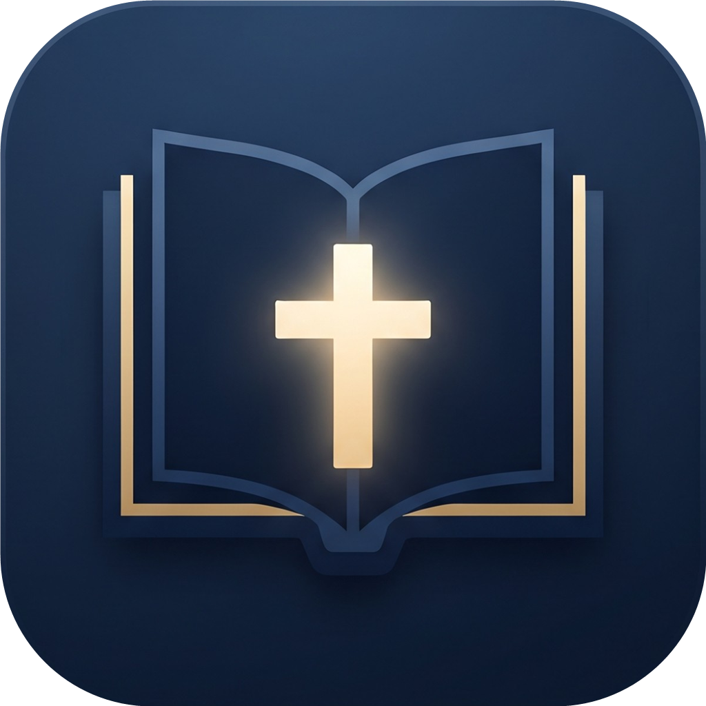
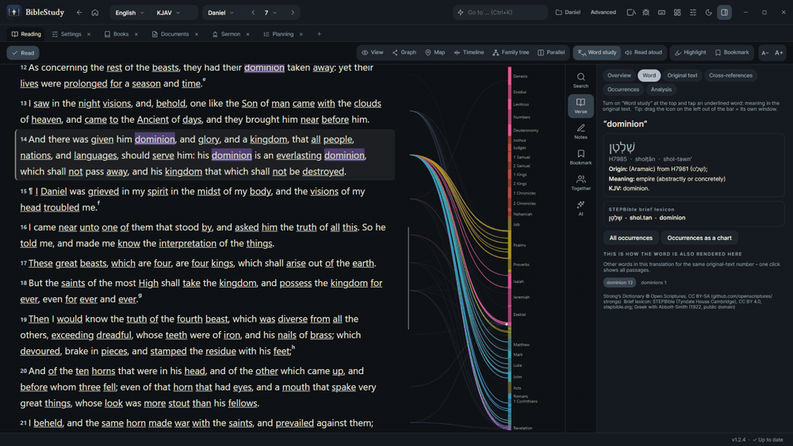
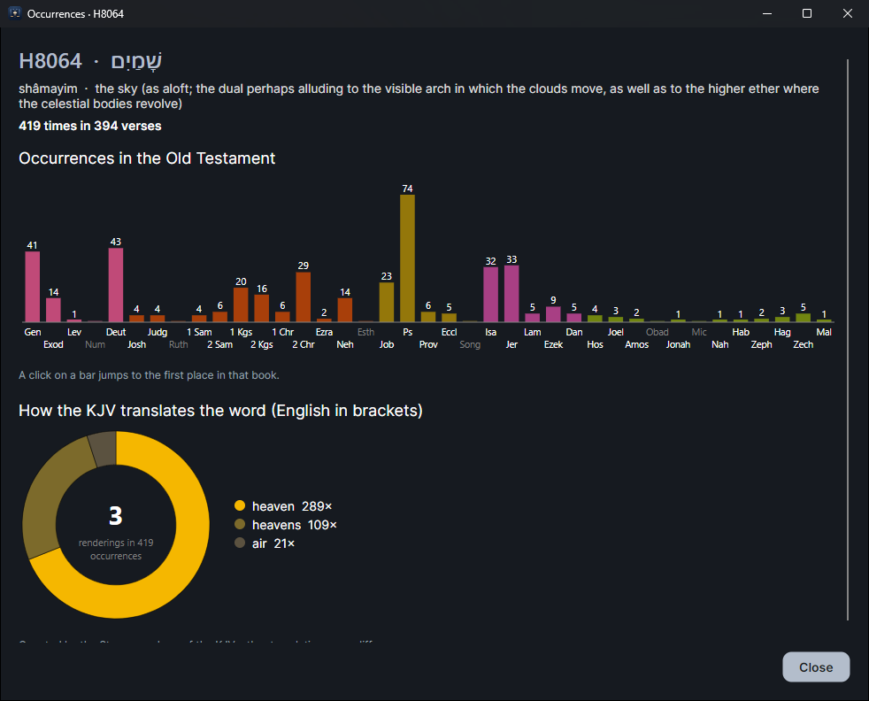
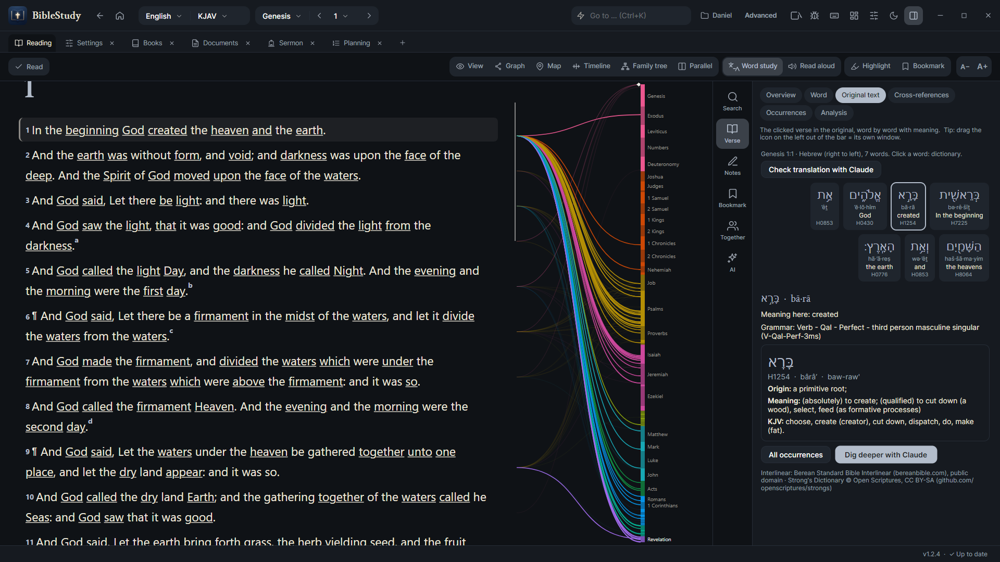

<p align="center"></p>

<p align="center">
  <a href="https://github.com/Trofline/BibleStudy/releases/latest"></a>
  <a href="LICENSE"></a>
  <a href="https://github.com/Trofline/BibleStudy/actions/workflows/build.yml"></a>
  <a href="https://github.com/Trofline/BibleStudy/actions/workflows/codeql.yml"></a>
  
</p>
<p align="center"><a href="https://trofline.github.io/BibleStudy/">Website</a> · <a href="https://github.com/Trofline/BibleStudy/releases/latest">Download</a> · <a href="https://github.com/Trofline/BibleStudy/wiki">Wiki</a> · <a href="docs/handbuch/README.md">Handbuch</a></p>

# BibleStudy

Freie, quelloffene Bibelstudien-Software für Windows, Linux und macOS (C#, .NET 10, Avalonia). Lesen, vergleichen, markieren, Notizen und Dokumente
verknüpfen, Predigten vorbereiten – alles offline nutzbar und ohne Konto.

*[English version](README.md)* · *[Das Handbuch](docs/handbuch/README.md): jede Funktion, jedes Tastenkürzel, Strategien*

<p align="center"><a href="docs/img/tour.gif"></a></p>

<p align="center">
  <a href="docs/img/occurrences.png"></a>
  <a href="docs/img/original-text.png"></a>
</p>

## Was kann es?

- **Lesen und vergleichen:** viele freie Übersetzungen, Parallelspalten, Unterschiede zwischen Übersetzungen farbig markiert, dazu eine **Hörbibel** (gesprochene World English Bible, gemeinfrei, spielt Kapitel für Kapitel und läuft nach dem Laden auch offline)
- **Suche:** Wörter, Wendungen, Grundformen, Strong-Nummern, Bibelstellen, **Themensuche** mit verwandten Wörtern
- **Studium:** Wort-für-Wort-Grundtext, Strong-Wörterbuch, Querverweise (Graph, Netzwerk, Bogen), Kommentare, Bibellexikon
- **Zeitleiste mit Karte**, **Stammbaum** von Personen der Bibel
- **Eigenes Wissen:** Vaults (wie bei Obsidian) mit Markierungen, Notizen, Dokumenten, Ordnern, Tags, Wiki-Links
- **Planen:** Lesepläne mit Fortschritt, Leseliste, Aufgaben, **Gebetsliste**
- **Predigt-Editor** mit Gliederung, Versen, Zeitplan und Handout-Export
- **Morphologie und Syntax** des Urtextes (Griechisch und Hebräisch): Zeit, Fall, Person …, Syntax mit Subjekt, Verb, Objekt …
- **Morphologie und Syntax** des Urtextes (Griechisch und Hebräisch): Zeit, Fall, Person …, Syntax mit Subjekt, Verb, Objekt …
- **Analyse-Werkzeuge:** Schlüsselwörter und einmalige Wörter je Kapitel, verwandte Wörter, Verteilung eines Wortes über die Bibel
- **Satzdiagramm und Perikopen-Analyse:** der Satz eines Verses als klassisches Satzdiagramm (Reed–Kellogg, Griechisch und Hebräisch, Export als PNG/SVG) und ein Abschnitt in Bildern: Wortarten, Verbformen, Schlüsselwörter und wo sie vorkommen, Rhythmus der Verse, Satzbau und Verbindungen
- **Dokumente mit Kategorien**, Studienvorlagen und Wissensgraph
- **Zusammen studieren:** direkt mit einer anderen Person verbunden (verschlüsselt, kein Server, kein Konto, kostenlos): Chat, Verse und Dokumente teilen, der Stelle der anderen folgen; eingerichtet durch den Austausch von zwei kurzen Codes. Es ist eine direkte Verbindung ohne Relay-Server und klappt am besten im selben Netzwerk; über verschiedene Netzwerke hängt es von euren Anschlüssen ab (ein privates Netzwerk wie ZeroTier oder Tailscale oder ein eigener Relay-Server kann helfen, siehe Handbuch)
- **Linux und macOS:** Pakete werden mit gebaut (auf Windows gebaut; bisher nur auf einem Intel-Mac gestartet, sonst ungetestet), mit Schritt-für-Schritt-Anleitung im Paket (`README-macOS.txt`, `README-Linux.txt`), siehe Releases
- **Griechisch und Hebräisch lernen:** Alphabet, Buchstaben-Quiz, Vokabeltrainer mit Wiederholung
- **Drucken / PDF** für Dokumente, Lesepläne, Gebete und Predigt; Predigt-Folien als Vollbild-Show
- **Reiter wie im Explorer**, Layouts (Desktops), frei belegbare Tastenkürzel
- **Mehrsprachig:** Oberfläche auf Englisch, Deutsch, Spanisch, Französisch und Russisch (KI-erstellte Übersetzungen, Korrekturen willkommen; weitere Sprachen als JSON-Datei im Ordner `lang` ergänzbar)
- **KI-Anbindung (optional):** MCP-Server, damit Claude das Programm bedienen kann
- **Plugins:** zusätzliche Übersetzungen, Befehle und Zugriff auf das Programm (siehe [PLUGINS.md](PLUGINS.md)). Fertige Plugins liegen im Ordner [`plugins`](plugins) und in jedem Release, zum Beispiel **Strong-Nummern ergänzen** (fügt Übersetzungen ohne Strong-Nummern eine *geschätzte* Nummerierung hinzu; keine Garantie, bitte prüfen)

## Installation

Lade unter [Releases](https://github.com/Trofline/BibleStudy/releases) eine der beiden Dateien:

| Datei | Wofür |
|---|---|
| `BibleStudy-Setup-x.y.z.exe` | Installer (ohne Administratorrechte), mit Deinstallation und automatischen Updates |
| `BibleStudy-Portable-x.y.z.zip` | Portable Version: entpacken und starten; alle Daten liegen im Ordner `Data` daneben |

**Deine Daten sind geschützt:** Installiert liegen sie in `%LOCALAPPDATA%\BibleStudy`, also getrennt vom Programm. Updates und
Neuinstallationen berühren sie nicht, vor jedem Update wird zusätzlich eine Sicherung in `Dokumente\BibleStudy-Backup` angelegt.
Beim Deinstallieren (und beim Entfernen der portablen Version) wirst du immer gefragt, ob deine Daten erhalten bleiben sollen.

## Selbst bauen

```powershell
dotnet run --project src/BibleStudy.App      # Entwicklung
powershell -ExecutionPolicy Bypass -File .\release.ps1 -Version 1.0.0   # Installer + Portable-Paket in .\release
```

## Lizenzen und Quellen

Der Programmcode steht unter der [MIT-Lizenz](LICENSE). **Das Programm enthält keine Bibeltexte.** Übersetzungen, Kommentare und Daten
werden auf deinen Wunsch von ihren Originalquellen geladen; die Lizenz steht jeweils in der Fußzeile und im Programm unter
*Einstellungen → Quellen und Lizenzen*. Alle Quellen: [THIRD-PARTY-NOTICES.md](THIRD-PARTY-NOTICES.md).
Eigene Dateien, die du importierst (z. B. eine Elberfelder-CSV), bleiben auf deinem Rechner und sind nur für deinen privaten Gebrauch.

**Keine Gewähr, keine Haftung.** BibleStudy ist freie Software und wird „wie besehen“ ohne jede Gewähr bereitgestellt (siehe Lizenz). Soweit gesetzlich zulässig, haften die Entwickler nicht für Schäden aus der Nutzung; die Haftung für Vorsatz, grobe Fahrlässigkeit, Schäden an Leben, Körper und Gesundheit sowie jede gesetzlich nicht ausschließbare Haftung bleibt unberührt. Inhalte Dritter (Übersetzungen, Kommentare, Daten), eigene Importe und alles, was du teilst, liegen in deiner Verantwortung. Beim ersten Start fragt das Programm die Zustimmung zu kurzen Nutzungsbedingungen ab.

## Mitmachen

Fehler und Wünsche bitte als [Issue](https://github.com/Trofline/BibleStudy/issues) melden. Beiträge sind willkommen; mit einem
Pull Request stimmst du zu, dass dein Beitrag unter der MIT-Lizenz steht. Bitte nur Daten und Texte mit klarer, freier Lizenz einbauen.


