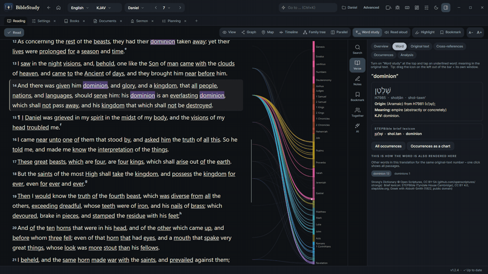
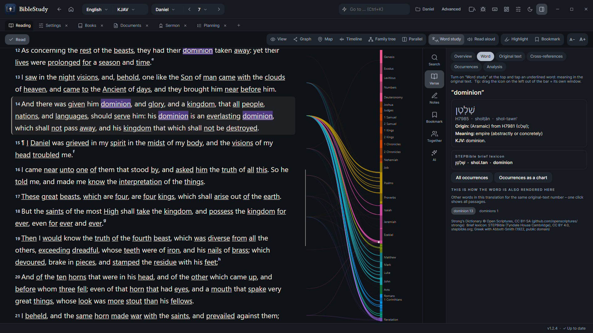
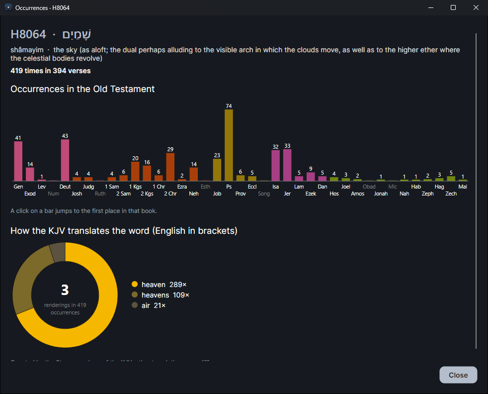
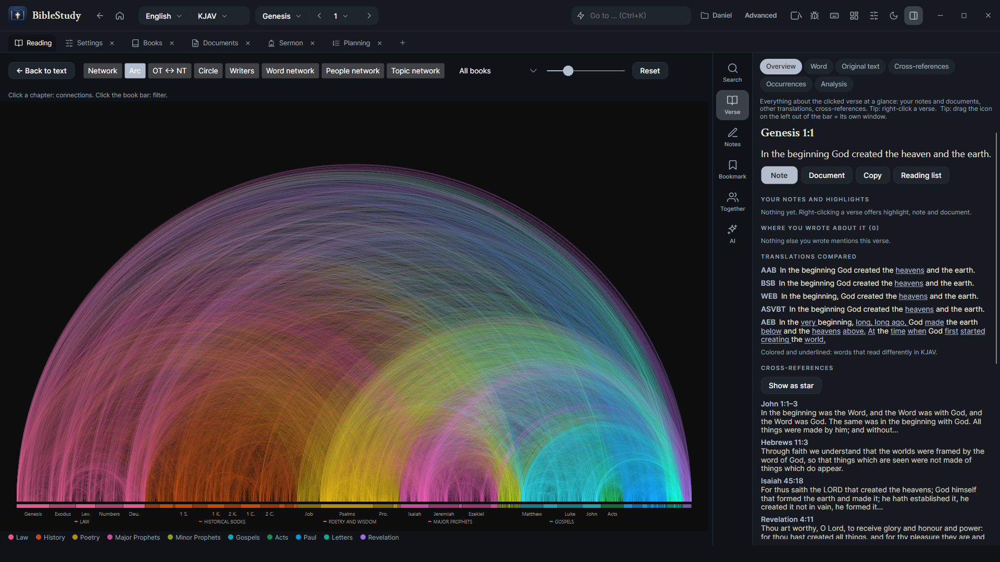
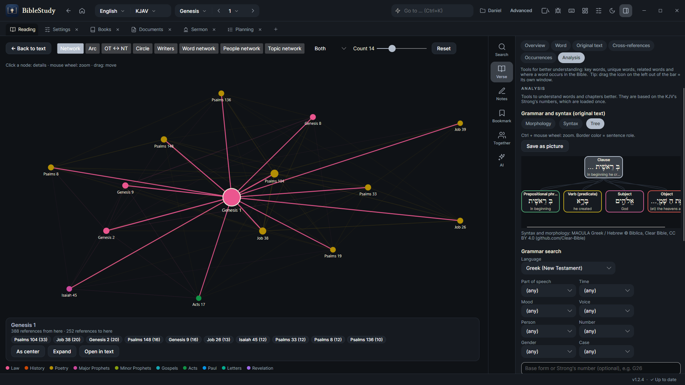
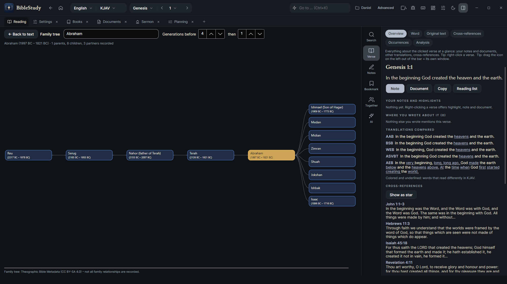

<p align="center"></p>

<p align="center"><a href="README.md"></a> <a href="README.de.md"></a></p>

<h1 align="center">BibleStudy</h1>

<p align="center"><b>Free Bible study software for your PC and your phone.</b><br>
Read, compare, highlight, take notes, study the Greek and Hebrew, prepare and lead a Bible study.<br>
Works offline. No account. No ads. Open source.</p>

<p align="center">
  <a href="https://github.com/Trofline/BibleStudy/releases/latest"></a>
  <a href="LICENSE"></a>
  <a href="https://github.com/Trofline/BibleStudy/actions/workflows/build.yml"></a>
  
</p>

<p align="center"><a href="https://trofline.github.io/BibleStudy/">Website</a> · <a href="docs/handbook/README.md">Handbook</a> · <a href="https://github.com/Trofline/BibleStudy/issues">Report a problem</a></p>

<br>

<p align="center"><a href="docs/img/tour.gif"></a></p>

## ⬇️ Download: pick your device

<table>
  <tr>
    <th align="center" width="20%">🪟<br>Windows</th>
    <th align="center" width="20%">🍎<br>macOS</th>
    <th align="center" width="20%">🐧<br>Linux</th>
    <th align="center" width="20%">🤖<br>Android</th>
    <th align="center" width="20%">📱<br>iPhone</th>
  </tr>
  <tr>
    <td align="center"><a href="#install-on-windows">Install guide</a><br><sub>1 minute</sub></td>
    <td align="center"><a href="#install-on-macos">Install guide</a><br><sub>2 minutes</sub></td>
    <td align="center"><a href="#install-on-linux">Install guide</a><br><sub>2 minutes</sub></td>
    <td align="center"><a href="#install-on-android">Install guide</a><br><sub>1 minute · beta</sub></td>
    <td align="center"><a href="#install-on-iphone">Install guide</a><br><sub>10 minutes · beta</sub></td>
  </tr>
</table>

All files are in the **[latest release](https://github.com/Trofline/BibleStudy/releases/latest)**. Your PC and your phone can [sync with each other](#sync-your-devices), with no account and no server.

## 🖼️ What it looks like

<table>
  <tr>
    <td width="50%"><a href="docs/img/reading.png"></a></td>
    <td width="50%"><a href="docs/img/original-text.png"></a></td>
  </tr>
  <tr>
    <td align="center"><b>Read with word study</b><br><sub>Tap a word: original word, meaning, every place it occurs</sub></td>
    <td align="center"><b>Original text, word by word</b><br><sub>Greek and Hebrew with grammar and dictionary</sub></td>
  </tr>
  <tr>
    <td><a href="docs/img/occurrences.png"></a></td>
    <td><a href="docs/img/arc.png"></a></td>
  </tr>
  <tr>
    <td align="center"><b>Where a word occurs</b><br><sub>Spread across books and chapters at a glance</sub></td>
    <td align="center"><b>Cross-references as arcs</b><br><sub>How a passage links through the whole Bible</sub></td>
  </tr>
  <tr>
    <td><a href="docs/img/network.png"></a></td>
    <td><a href="docs/img/family-tree.png"></a></td>
  </tr>
  <tr>
    <td align="center"><b>Networks</b><br><sub>Verses, words, people and topics as a graph</sub></td>
    <td align="center"><b>Family tree</b><br><sub>Bible people and how they are related</sub></td>
  </tr>
</table>

> [!NOTE]
> The guiding principle is **Scripture alone**: the Bible text comes first. BibleStudy ships no commentaries; if you like, you read in your own.

## ✨ What you can do

| | |
|---|---|
| 📖 **Read and compare** | Many free translations, parallel columns, differences highlighted, an **audio Bible** that works offline |
| 🔎 **Search** | Words, phrases, base forms, Strong's numbers, people and places, words of Jesus only, topic search, a search builder, results on a map or as a graph |
| 🏛️ **Study the original** | Greek and Hebrew word by word, Strong's dictionary, grammar of every word, sentence structure, sentence diagrams |
| 🖍️ **Your own notes** | Highlights, notes, documents, folders, categories, tags, wiki links and a knowledge graph, in vaults like Obsidian |
| 👥 **Lead a Bible study** | Your Word/PDF/PowerPoint files inside the program with clickable Bible references, split view, handouts in eight looks, a projector view, a timer with a program for the evening |
| 🎤 **Sermons** | Editor with outline, verses, time plan, handout, slides and PDF export |
| 📅 **Plan** | Reading plans with progress, reading list, tasks, prayer list |
| 🎓 **Learn** | Greek and Hebrew alphabets, vocabulary trainer, verses by heart |
| 🗺️ **Explore** | Timeline with map, journeys, family tree |
| 🔄 **Sync and share** | Sync PC and phone, study together with another person (encrypted, no server), backups |
| 🧩 **Extend** | Plugins, five languages (English, German, Spanish, French, Russian), optional AI integration (MCP server for Claude) |

<details>
<summary><b>The full feature list</b></summary>

- **Read and compare:** many free translations, parallel columns (color-coded, optional synchronous scrolling), differences between translations highlighted, plus an **audio Bible** (spoken World English Bible, public domain, plays chapter after chapter and works offline once downloaded)
- **Search:** words, phrases, base forms, Strong's numbers, passages, search options (word beginning/ending, original-language words, proximity), **people and places** (`Person:Abraham`), **Old/New Testament references** (`Bezug:"Jer 31"`), **words of Jesus only**, a search builder, saved searches, many graph views (network, arcs, OT/NT, circle, writers, word/people/topic networks), journeys on the map, a Greek/Hebrew keyboard, clause search by syntactic roles, hits on the map, an OT/NT reference network and a **topic search**
- **Study:** word-by-word original text, Strong's dictionary, cross-references (graph, network, arc), Bible dictionary
- **Analysis tools:** morphology (every word's tense, case, person …) and **syntax** (clause structure with subject, verb, object …) for Greek and Hebrew; key words and unique words per chapter, related words, distribution of a word across the Bible
- **Sentence diagram and pericope analysis:** the sentence of a verse drawn as a classical sentence diagram (Reed–Kellogg, Greek and Hebrew, PNG/SVG export), and a passage in pictures: word classes, verb forms, key words and where they occur, rhythm of the verses, sentence build and links
- **Learn Greek and Hebrew:** alphabets, letter quiz, vocabulary trainer with spaced repetition
- **Timeline with map**, **family tree** of Bible people
- **Your own knowledge:** vaults (like Obsidian) with highlights (free text selection across verses, sub-highlights, one-click color change), notes, documents, folders, **categories**, tags, wiki links, study templates and a knowledge graph
- **Plan:** reading plans with progress, reading list, tasks, **prayer list**
- **Sermon editor** with outline, verses, time plan, handout, slides and print/PDF export
- **Bible study:** materials folder (Word, PDF, PowerPoint, OpenDocument, Markdown …) with clickable references, a verse preview when you rest the mouse on one, search across all files, marks and notes without changing the files; split view; handouts in eight looks; projector view; clock, timer and a program for the evening
- **Tabs like in a file explorer**, layouts (including a dashboard), custom keyboard shortcuts, animations
- **Multilingual:** English, German, Spanish, French and Russian (AI-made translations, corrections welcome; more languages can be added as a JSON file in the `lang` folder)
- **Study together:** connect directly with one other person (encrypted, no server, no account, free): chat, share verses and documents, follow each other's place; set up by swapping two short codes. It works best in the same network; across networks a private network such as ZeroTier or Tailscale, or your own relay server, can help (see the handbook)
- **Sync your devices:** PC, Android and iPhone keep each other up to date in the same Wi-Fi, or through a cloud folder (OneDrive, Google Drive, Dropbox …)
- **Backups:** manual or scheduled, to a folder of your choice
- **AI integration (optional):** MCP server so that Claude can operate the program
- **Plugins:** extra translations, commands and program access (see [PLUGINS.md](PLUGINS.md)). Ready-made plugins are in the [`plugins`](plugins) folder and in each release, for example **Strong-Nummern ergänzen** (adds an *estimated* Strong's numbering to translations that have none; no guarantee, please check)

</details>

## 💛 You are not on your own

> [!IMPORTANT]
> **BibleStudy is here to stay.** I keep the app alive: it keeps getting updates, and bugs get fixed. You do not need to worry that it is left behind one day.

**Every problem counts, even if it only happens to you.** Your bought book does not import well, something looks wrong on your device, you have an idea, or you simply do not get on: I look after every person myself and help you personally until it works. No question is too small, and nobody is told "that only affects you".

**How to reach me:** in the program under **Settings → Feedback** ("Report a bug", "Suggest an idea", "Give feedback"), or directly as an [issue on GitHub](https://github.com/Trofline/BibleStudy/issues). Writing in German or English is fine.

---

## 📥 Installation

> [!TIP]
> **Your data is safe during updates.** Installed on Windows it lives in `%LOCALAPPDATA%\BibleStudy`, apart from the program. Updates and reinstalls never touch it, a backup is made before every update, and when you uninstall you are asked whether to keep it.

### Install on Windows

1. Download **`BibleStudy-Setup-x.y.z.exe`** from the [latest release](https://github.com/Trofline/BibleStudy/releases/latest).
2. Open it. No admin rights needed. The program updates itself from then on.

<sub>Prefer no installer? Take **`BibleStudy-Portable-x.y.z.zip`**, unpack it and run it. All data stays in the `Data` folder next to it.</sub>

### Install on macOS

1. Download **`BibleStudy-macOS-arm64-x.y.z.zip`** (Apple chip, M1 and newer) or **`BibleStudy-macOS-x64-x.y.z.zip`** (Intel) from the [latest release](https://github.com/Trofline/BibleStudy/releases/latest).
2. Unpack it and start **`Start-BibleStudy.command`**. The included `README-macOS.txt` explains the first start step by step.

### Install on Linux

1. Download **`BibleStudy-Linux-x64-x.y.z.tar.gz`** from the [latest release](https://github.com/Trofline/BibleStudy/releases/latest).
2. Unpack it and follow `README-Linux.txt`.

> [!NOTE]
> macOS and Linux packages are built on Windows and have been tried on a few machines only. If something does not start, please [open an issue](https://github.com/Trofline/BibleStudy/issues).

### Install on Android

1. On the phone, download **`BibleStudy-Android-x.y.z.apk`** from the [latest release](https://github.com/Trofline/BibleStudy/releases/latest).
2. Open it and allow the install. The app updates itself from then on.

### Install on iPhone

**Free.** Apple lets only the App Store install apps, so BibleStudy comes through [SideStore](https://sidestore.io), which signs the app with your own free Apple ID. You need **a computer (Windows or Mac) and a cable once**. About 10 minutes in total.

**What you will do:** put SideStore on the iPhone with the computer → allow it on the iPhone → install BibleStudy → add one ready-made shortcut. That is all.

<table>
<tr><td>

**① Put SideStore on the iPhone** <sub>· on the computer · 4 min</sub>

1. Windows only: install **Apple Devices** (Microsoft Store) or **iTunes**. On a Mac nothing is needed.
2. Open **[iloader](https://github.com/nab138/iloader)** and connect the iPhone with the cable.
3. The iPhone asks **"Trust This Computer?"** → tap **Trust** and enter your passcode.
4. In iloader sign in with your Apple ID and install **SideStore**.

</td></tr>
<tr><td>

**② Trust your own Apple ID** <sub>· on the iPhone · 1 min</sub>

Without this, SideStore will not open ("Untrusted Developer").

**Settings** → **General** → **VPN & Device Management** → under *Developer App* tap your Apple ID (your email address) → **Trust "…"** → **Trust**

</td></tr>
<tr><td>

**③ Turn on Developer Mode** <sub>· on the iPhone · 2 min</sub>

Without it, iOS will not open apps you signed yourself.

1. **Settings** → **Privacy & Security** → scroll all the way down → **Developer Mode** → switch on.
2. iOS asks to restart → tap **Restart**.
3. After the restart, unlock the iPhone. **"Turn On Developer Mode?"** appears → tap **Turn On** and enter your passcode.

> [!TIP]
> **No "Developer Mode" in the list?** It only appears once SideStore is installed. Tap SideStore once (it says Developer Mode is needed), then look again. Still missing: step ① did not finish.

</td></tr>
<tr><td>

**④ Install LocalDevVPN** <sub>· on the iPhone · 1 min</sub>

Get **LocalDevVPN** from the App Store, open it once and tap **Allow** for the VPN configuration.

<sub>SideStore talks to the iPhone through this tiny VPN on the phone itself. It sends no data anywhere. You never switch it yourself; step ⑥ does that.</sub>

</td></tr>
<tr><td>

**⑤ Install BibleStudy** <sub>· on the iPhone · 2 min</sub>

1. Open SideStore and sign in with your Apple ID.
2. On the iPhone tap **[this link](sidestore://source?url=https://trofline.github.io/BibleStudy/sidestore.json)**.<br><sub>Or in SideStore: **Sources** → **+** → `https://trofline.github.io/BibleStudy/sidestore.json`</sub>
3. Open **BibleStudy** in the list → **Install**.

<sub>You do **not** download the `.ipa` file yourself: through this source SideStore fetches it straight from the latest release, for every update too.</sub>

</td></tr>
<tr><td>

**⑥ Add the ready-made shortcut** <sub>· on the iPhone · 1 min</sub>

1. On the iPhone open **[BibleStudy.shortcut](https://trofline.github.io/BibleStudy/BibleStudy.shortcut)** in Safari → **Download**.
2. Tap the download arrow at the top right → tap the file → it opens in **Shortcuts**.
3. Tap **Add Shortcut**. If iOS later asks whether it may use the VPN: **Always Allow**.

**Done.** From now on the VPN goes on when SideStore opens and off when it closes, and every 6 days the iPhone re-signs BibleStudy by itself, so the app never expires.

</td></tr>
</table>

#### 🔄 Updating on the iPhone

BibleStudy **tells you** when a new version is out (a small notice in the app). It cannot install it by itself: iOS lets no app install another, so you do the update **by hand in SideStore**:

1. **Open SideStore** yourself (from the home screen; the button in the notice may open it for you).
2. Tap **Sources** at the bottom → **pull the list down** once, so SideStore looks for the new version.
3. Tap **My Apps** at the bottom → at **BibleStudy** tap **Update**.

<sub>Your data stays. If no **Update** shows yet, wait a few minutes and pull down in **Sources** again.</sub>

<details>
<summary><b>iPhone: problems and limits</b></summary>

- **The source cannot be added:** download `BibleStudy-iOS-x.y.z.ipa` from the [latest release](https://github.com/Trofline/BibleStudy/releases/latest) on the iPhone, then in SideStore under **My Apps** tap **+** at the top left and pick the file.
- **The app expired anyway:** open SideStore and tap **Refresh** at BibleStudy. Your data stays.
- **SideStore says the pairing file is missing:** open iloader again with the iPhone connected, click **Manage Pairing File** at the bottom and place it for SideStore.
- **Limits:** a free Apple ID allows at most 3 self-signed apps at once (SideStore counts as one). After a long time switched off or a big iOS update a manual refresh may be needed once. Apple may restrict this method one day. SideStore changes now and then: if a step looks different, [docs.sidestore.io](https://docs.sidestore.io) is the reference.
- **PC only:** Claude Code, Ollama and the MCP server. The live Bible study runs only while the app is open.

</details>

### Sync your devices

Once set up, PC, Android and iPhone keep each other up to date: marks, notes, documents, tasks, reading progress, plans, verses by heart and more. **No account, no server.**

1. On the PC: **Settings** → **Sync devices** → **Set up syncing**. A QR code appears.
2. Scan it with the phone's camera. BibleStudy opens and pairs.
3. A small green notice **"Connected to …"** confirms it, then **"Synced with …"** once everything is transferred. You never pair again.

In the same Wi-Fi the devices sync by themselves every few seconds. When **"Synced with …"** appears, you can close the app on the phone. Away from home, pick a **cloud folder** (OneDrive, Google Drive, Dropbox …) in the same settings. Details: [handbook, chapter 19.3](docs/handbook/19-phone.md).

---

## 🛠️ Build it yourself

```powershell
dotnet run --project src/BibleStudy.App      # development
powershell -ExecutionPolicy Bypass -File .\release.ps1 -Version 1.0.0   # installer, portable and Linux/macOS packages in .\release
```

## 📜 Licenses and sources

The program code is under the [MIT license](LICENSE). **The program contains no Bible texts.** Translations, commentaries and data are
downloaded from their original sources on request; the license is shown in the footer and under *Settings → Sources and licenses*.
All sources: [THIRD-PARTY-NOTICES.md](THIRD-PARTY-NOTICES.md). Files you import yourself (e.g. a CSV Bible) stay on your computer and are for your private use only.

**No warranty, no liability.** BibleStudy is free software provided "as is", without warranty of any kind (see the license). To the extent permitted by law, the developers are not liable for damages arising from its use; liability for intent, gross negligence, injury to life, body or health and any liability that cannot be excluded by law remains unaffected. Content from third parties (translations, commentaries, data), your own imports and anything you share are your responsibility. The program asks for agreement to short terms of use at the first start.

## 🤝 Contributing

Please report bugs and wishes as an [issue](https://github.com/Trofline/BibleStudy/issues). Contributions are welcome; with a pull request
you agree that your contribution is released under the MIT license. Please only add data and texts with a clear, free license.
