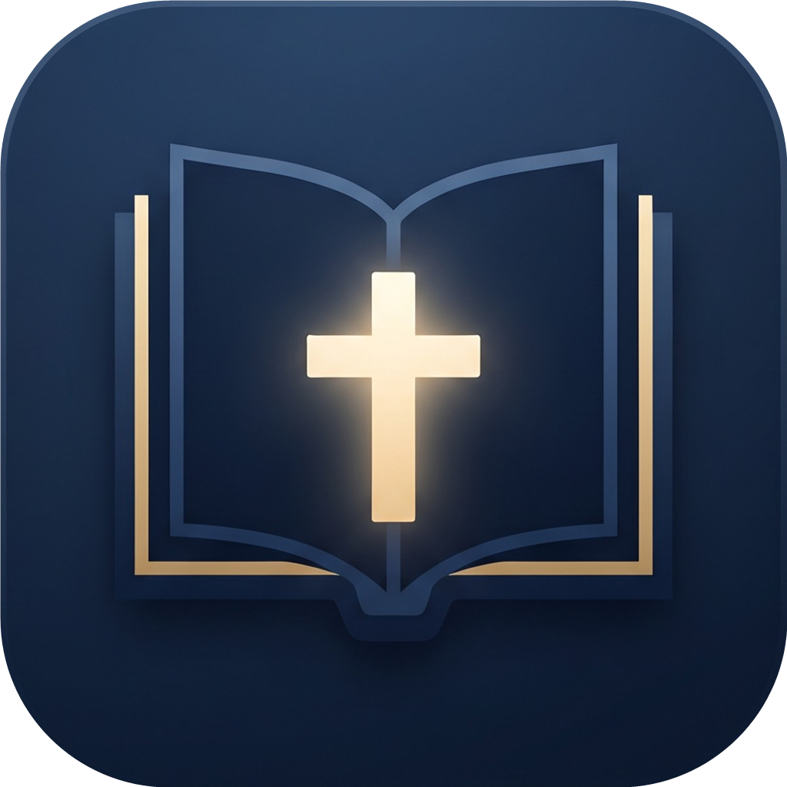
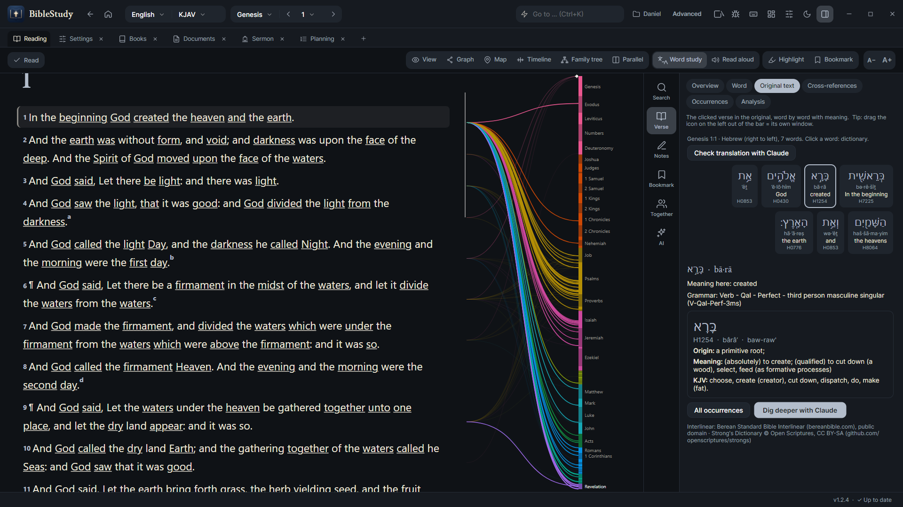
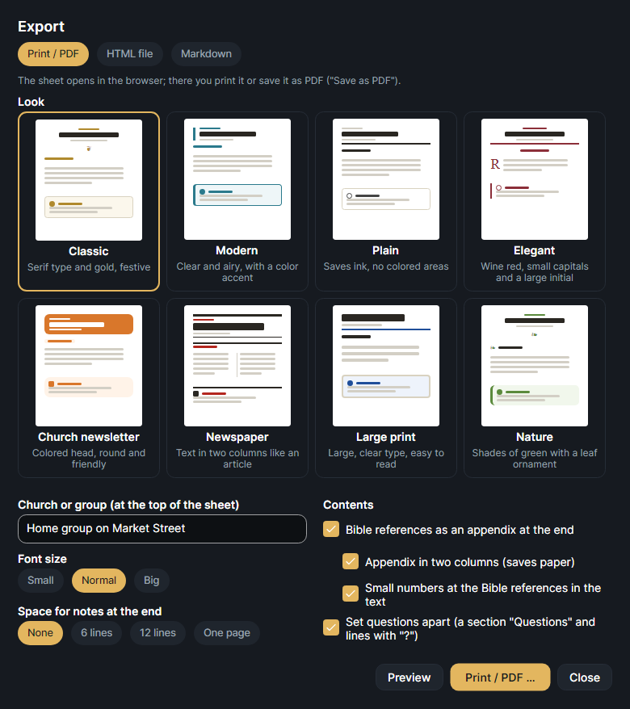
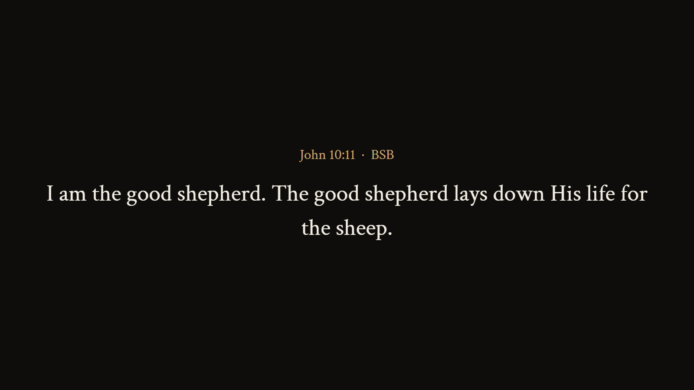

<p align="center"></p>

<p align="center">
  <a href="https://github.com/Trofline/BibleStudy/releases/latest"></a>
  <a href="LICENSE"></a>
  <a href="https://github.com/Trofline/BibleStudy/actions/workflows/build.yml"></a>
  <a href="https://github.com/Trofline/BibleStudy/actions/workflows/codeql.yml"></a>
  
</p>
<p align="center"><a href="https://trofline.github.io/BibleStudy/">Website</a> · <a href="https://github.com/Trofline/BibleStudy/releases/latest">Download</a> · <a href="https://github.com/Trofline/BibleStudy/wiki">Wiki</a> · <a href="docs/handbook/README.md">Handbook</a></p>

# BibleStudy

Free, open-source Bible study software for Windows, Linux and macOS (C#, .NET 10, Avalonia). Read, compare, highlight, link notes and
documents, analyze the original text, prepare sermons – works offline, no account needed.

*[Deutsche Version](README.de.md)* · *[Handbook (full manual)](docs/handbook/README.md)* · *[Handbuch (Deutsch)](docs/handbuch/README.md)*

The guiding principle is **Scripture alone**: the Bible text comes first. Commentaries (human writings) are hidden unless you switch them on.

<p align="center"><a href="docs/img/tour.gif"></a></p>

<p align="center">
  <a href="docs/img/occurrences.png"></a>
  <a href="docs/img/original-text.png"></a>
</p>

## Lead a Bible study

Prepare and hold a Bible study in one program: your own papers open right inside it, the passage stands beside them, the handout comes out designed, and the verses go up on the projector.

<p align="center"><a href="docs/img/split-view.png"></a></p>

- **Your materials inside the program:** Word, PDF, PowerPoint, OpenDocument, Markdown and more open in the *Materials* tab. Bible references in them are clickable, resting the mouse on one shows the verse, and you can search all files at once.
- **Marks and notes in your papers**, without changing the files themselves.
- **Split view:** the Bible on one side, your materials or documents on the other.
- **Handouts in eight looks:** print any document as a designed sheet, with the verses as an appendix, questions set apart and room for notes. HTML and Markdown export too.
- **Projector view:** verses or parts of your materials large and calm on a second screen.
- **A program for the timer:** song, prayer, Bible study … each part with its time, and a short tone when the next one begins.

<p align="center">
  <a href="docs/img/materials.png"></a>
  <a href="docs/img/handout-looks.png"></a>
  <a href="docs/img/projector.png"></a>
</p>

## Features

- **Read and compare:** many free translations, parallel columns (color-coded, optional synchronous scrolling), differences between translations highlighted, plus an **audio Bible** (spoken World English Bible, public domain, plays chapter after chapter and works offline once downloaded)
- **Search:** words, phrases, base forms, Strong's numbers, passages, search options (word beginning/ending, original-language words, proximity), **people and places** (`Person:Abraham`), **Old/New Testament references** (`Bezug:"Jer 31"`), **words of Jesus only**, a search builder, saved searches, many graph views (network, arcs, OT/NT, circle, writers, word/people/topic networks), journeys on the map, a Greek/Hebrew keyboard, clause search by syntactic roles, hits on the map, an OT/NT reference network and a **topic search**
- **Study:** word-by-word original text, Strong's dictionary, cross-references (graph, network, arc), Bible dictionary
- **Analysis tools:** morphology (every word's tense, case, person …) and **syntax** (clause structure with subject, verb, object …) for Greek and Hebrew; key words and unique words per chapter, related words, distribution of a word across the Bible
- **Learn Greek and Hebrew:** alphabets, letter quiz, vocabulary trainer with spaced repetition
- **Timeline with map**, **family tree** of Bible people
- **Your own knowledge:** vaults (like Obsidian) with highlights (free text selection across verses, sub-highlights, one-click color change), notes, documents, folders, **categories**, tags, wiki links, study templates and a knowledge graph
- **Plan:** reading plans with progress, reading list, tasks, **prayer list**
- **Sermon editor** with outline, verses, time plan, handout, slides and print/PDF export
- **Bible study:** materials folder (Word, PDF, PowerPoint …) with clickable references, search, marks and notes; split view; handouts in eight looks; projector view; clock, timer and a program for the evening
- **Tabs like in a file explorer**, layouts (including a dashboard), custom keyboard shortcuts, animations
- **Multilingual:** English, German, Spanish, French and Russian (AI-made translations, corrections welcome; more languages can be added as a JSON file in the `lang` folder)
- **Sentence diagram and pericope analysis:** the sentence of a verse drawn as a classical sentence diagram (Reed–Kellogg, Greek and Hebrew, PNG/SVG export), and a passage in pictures: word classes, verb forms, key words and where they occur, rhythm of the verses, sentence build and links
- **Study together:** connect directly with one other person (encrypted, no server, no account, free): chat, share verses and documents, follow each other's place; set up by swapping two short codes. It is a direct connection without a relay server, so it works best in the same network; across different networks it depends on your connections (a private network such as ZeroTier or Tailscale, or your own relay server, can help; see the handbook)
- **Backups:** manual or scheduled, to a folder of your choice
- **AI integration (optional):** MCP server so that Claude can operate the program
- **Plugins:** extra translations, commands and program access (see [PLUGINS.md](PLUGINS.md)). Ready-made plugins are in the [`plugins`](plugins) folder and in each release, for example **Strong-Nummern ergänzen** (adds an *estimated* Strong's numbering to translations that have none; no guarantee, please check)

## Installation

Download a file from [Releases](https://github.com/Trofline/BibleStudy/releases):

| File | Purpose |
|---|---|
| `BibleStudy-Setup-x.y.z.exe` | Windows installer (no admin rights needed), with uninstaller and automatic updates |
| `BibleStudy-Portable-x.y.z.zip` | Windows portable version: unpack and run; all data lives in the `Data` folder next to it |
| `BibleStudy-Linux-x64-x.y.z.tar.gz`, `BibleStudy-macOS-arm64-x.y.z.zip` (Apple chip), `BibleStudy-macOS-x64-x.y.z.zip` (Intel) | Linux and macOS packages (built on Windows; the program was started on one Intel Mac so far, other systems are untested). Step-by-step instructions are inside: `README-macOS.txt` (German and English; on the Mac you start `Start-BibleStudy.command`) or `README-Linux.txt` |

**Your data is protected:** when installed, it lives in `%LOCALAPPDATA%\BibleStudy`, separate from the program. Updates and reinstalls never
touch it, and a backup is made before every update. When you uninstall (or remove the portable version) you are always asked whether to keep your data.

## On the phone

**Android:** download `BibleStudy-Android-…apk` from the [latest release](https://github.com/Trofline/BibleStudy/releases/latest) (beta) and open it. After that the app updates itself.

**iPhone (beta), free and without a Mac:** Apple only lets the App Store install apps, so BibleStudy is installed with [SideStore](https://sidestore.io), which signs the app with your own free Apple ID. You need **a Windows PC (or Mac) with a cable once**; afterwards the phone renews the app by itself. About 10 minutes in total.

1. **Put SideStore on the iPhone (about 4 min).** On the PC install *Apple Devices* (Microsoft Store) or iTunes, then open [iloader](https://github.com/nab138/iloader), connect the iPhone with the cable, sign in with your Apple ID and install SideStore. iloader also creates the *pairing file* that SideStore needs. If SideStore later says the pairing file is missing: open iloader again with the iPhone connected, click **Manage Pairing File** at the bottom and place it for SideStore.
2. **Trust and Developer Mode (about 2 min).** iPhone: Settings → General → VPN & Device Management → trust your Apple ID. Settings → Privacy & Security → Developer Mode → on (the iPhone restarts).
3. **Install a loopback VPN (about 1 min).** SideStore talks to the phone itself through a tiny on-device VPN that sends no data anywhere. Install **StosVPN** (or *LocalDevVPN*) from the App Store and switch it on once.
4. **Add BibleStudy (about 2 min).** Open SideStore, sign in, then tap [this link](sidestore://source?url=https://trofline.github.io/BibleStudy/sidestore.json) on the iPhone (or Sources → **+** → `https://trofline.github.io/BibleStudy/sidestore.json`). Open BibleStudy in the list and tap **Install**.
5. **Renew by itself every day (about 2 min).** A free Apple ID signs an app for 7 days only. Make an automation so you never think about it:
   1. Open **Shortcuts → Shortcuts → +** and add these actions in this order: *Connect to VPN / turn on* StosVPN (action of the VPN app), **Refresh All Apps** (SideStore's own action), then turn the VPN off again. Name it **Renew BibleStudy**.
   2. **Shortcuts → Automation → +** → **Time of Day** (for example 3:00, daily) → **Run Immediately** → choose the shortcut. Turn off *Notify When Run* if you like.
   3. Leave the phone charging at night with Wi-Fi on, that is when it runs.
6. **Sync with the PC when you get home (about 1 min).** The iPhone syncs only while BibleStudy is open. To make that happen by itself: **Shortcuts → Automation → +** → **Wi-Fi** → choose your Wi-Fi, tick **Joins** → **Run Immediately** → **Next** → **New Blank Automation** → action **Open App** → **BibleStudy**. When you come home the app opens for a moment and syncs. Setting up the sync: handbook chapter 19.3.

If an app has expired anyway: open SideStore and tap **Refresh** at BibleStudy; your data stays. Updates arrive through SideStore.

**Honest limits:** a free Apple ID allows at most 3 self-signed apps at the same time (SideStore counts as one). After a long time switched off or a big iOS update a manual refresh can be needed once. Apple may restrict the method one day. Claude Code, Ollama and the MCP server exist only on the PC, and the live Bible study runs only while the app is open. SideStore changes now and then: if a step looks different, [docs.sidestore.io](https://docs.sidestore.io) is the reference.

## Build it yourself

```powershell
dotnet run --project src/BibleStudy.App      # development
powershell -ExecutionPolicy Bypass -File .\release.ps1 -Version 1.0.0   # installer, portable and Linux/macOS packages in .\release
```

## Licenses and sources

The program code is under the [MIT license](LICENSE). **The program contains no Bible texts.** Translations, commentaries and data are
downloaded from their original sources on request; the license is shown in the footer and under *Settings → Sources and licenses*.
All sources: [THIRD-PARTY-NOTICES.md](THIRD-PARTY-NOTICES.md). Files you import yourself (e.g. a CSV Bible) stay on your computer and are for your private use only.

**No warranty, no liability.** BibleStudy is free software provided "as is", without warranty of any kind (see the license). To the extent permitted by law, the developers are not liable for damages arising from its use; liability for intent, gross negligence, injury to life, body or health and any liability that cannot be excluded by law remains unaffected. Content from third parties (translations, commentaries, data), your own imports and anything you share are your responsibility. The program asks for agreement to short terms of use at the first start.

## Contributing

Please report bugs and wishes as an [issue](https://github.com/Trofline/BibleStudy/issues). Contributions are welcome; with a pull request
you agree that your contribution is released under the MIT license. Please only add data and texts with a clear, free license.
