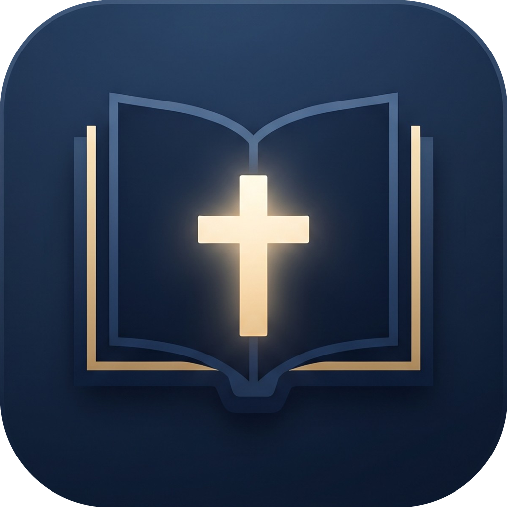

<p align="center"></p>

# BibleStudy

Free, open-source Bible study software for Windows, Linux and macOS (C#, .NET 10, Avalonia). Read, compare, highlight, link notes and
documents, analyze the original text, prepare sermons – works offline, no account needed.

*[Deutsche Version](README.de.md)*

The guiding principle is **Scripture alone**: the Bible text comes first. Commentaries (human writings) are hidden unless you switch them on.

## Features

- **Read and compare:** many free translations, parallel columns (color-coded, optional synchronous scrolling), differences between translations highlighted
- **Search:** words, phrases, base forms, Strong's numbers, passages, and a **topic search** with related words
- **Study:** word-by-word original text, Strong's dictionary, cross-references (graph, network, arc), Bible dictionary
- **Analysis tools:** morphology (every word's tense, case, person …) and **syntax** (clause structure with subject, verb, object …) for Greek and Hebrew; key words and unique words per chapter, related words, distribution of a word across the Bible
- **Learn Greek and Hebrew:** alphabets, letter quiz, vocabulary trainer with spaced repetition
- **Timeline with map**, **family tree** of Bible people
- **Your own knowledge:** vaults (like Obsidian) with highlights, notes, documents, folders, **categories**, tags, wiki links, study templates and a knowledge graph
- **Plan:** reading plans with progress, reading list, tasks, **prayer list**
- **Sermon editor** with outline, verses, time plan, handout, slides and print/PDF export
- **Tabs like in a file explorer**, layouts (including a dashboard), custom keyboard shortcuts, animations
- **Multilingual:** English, German, Spanish, French and Russian (AI-made translations, corrections welcome; more languages can be added as a JSON file in the `lang` folder)
- **Backups:** manual or scheduled, to a folder of your choice
- **AI integration (optional):** MCP server so that Claude can operate the program

## Installation

Download a file from [Releases](https://github.com/Trofline/BibleStudy/releases):

| File | Purpose |
|---|---|
| `BibleStudy-Setup-x.y.z.exe` | Windows installer (no admin rights needed), with uninstaller and automatic updates |
| `BibleStudy-Portable-x.y.z.zip` | Windows portable version: unpack and run; all data lives in the `Data` folder next to it |
| `BibleStudy-Linux-x64-x.y.z.tar.gz`, `BibleStudy-macOS-*-x.y.z.zip` | Linux and macOS packages (built on Windows, **untested**; see `README-Unix.txt` inside) |

**Your data is protected:** when installed, it lives in `%LOCALAPPDATA%\BibleStudy`, separate from the program. Updates and reinstalls never
touch it, and a backup is made before every update. When you uninstall (or remove the portable version) you are always asked whether to keep your data.

## Build it yourself

```powershell
dotnet run --project src/BibleStudy.App      # development
powershell -ExecutionPolicy Bypass -File .\release.ps1 -Version 1.0.0   # installer, portable and Linux/macOS packages in .\release
```

## Licenses and sources

The program code is under the [MIT license](LICENSE). **The program contains no Bible texts.** Translations, commentaries and data are
downloaded from their original sources on request; the license is shown in the footer and under *Settings → Sources and licenses*.
All sources: [THIRD-PARTY-NOTICES.md](THIRD-PARTY-NOTICES.md). Files you import yourself (e.g. a CSV Bible) stay on your computer and are for your private use only.

## Contributing

Please report bugs and wishes as an [issue](https://github.com/Trofline/BibleStudy/issues). Contributions are welcome; with a pull request
you agree that your contribution is released under the MIT license. Please only add data and texts with a clear, free license.
